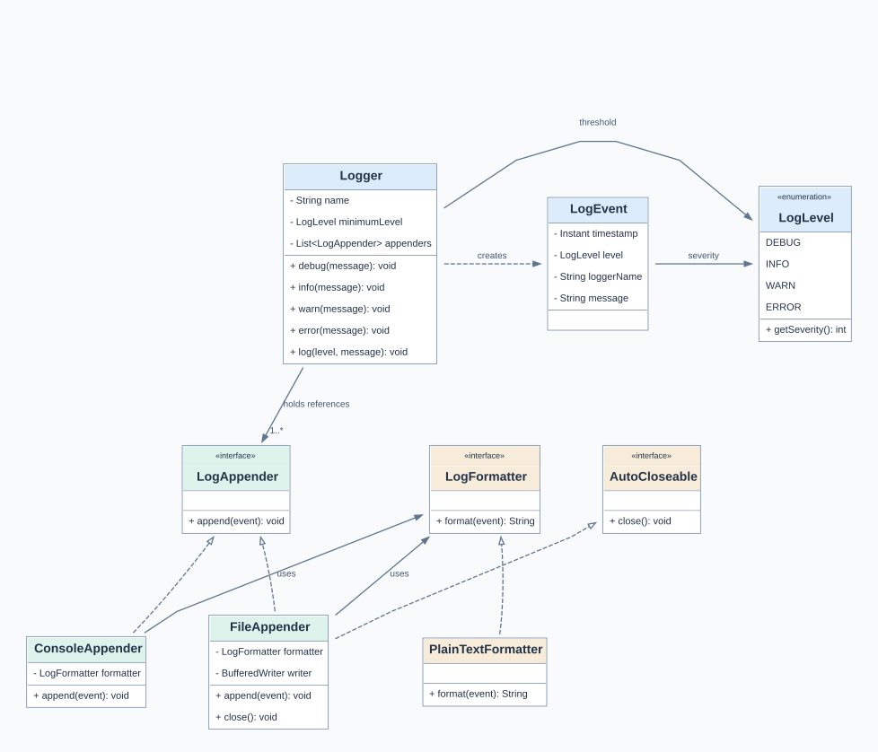
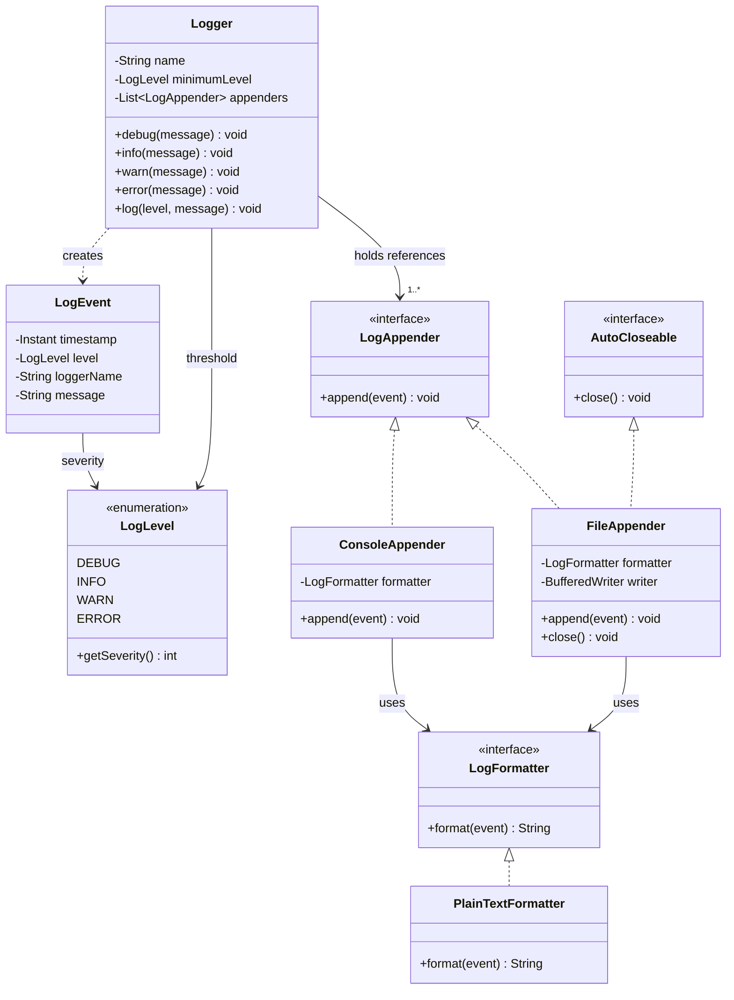
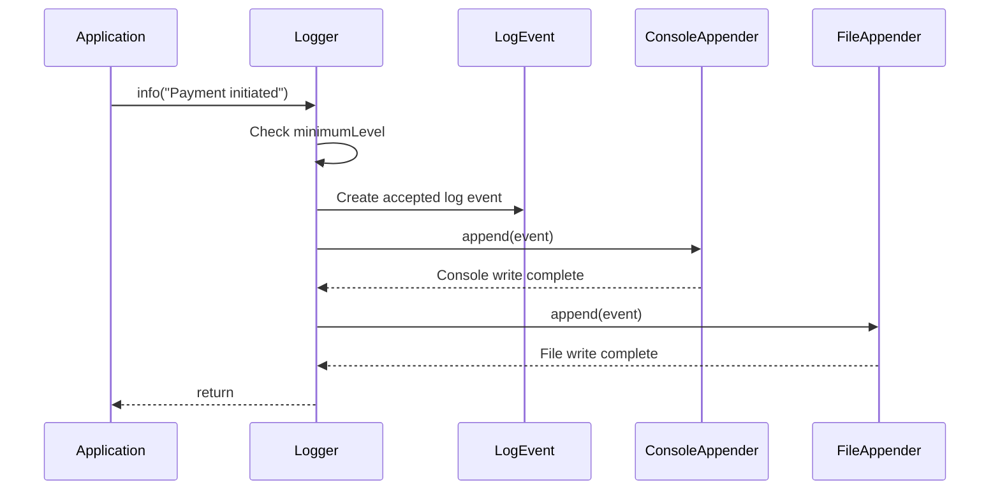

# Logging Framework — Low-Level Design (LLD)

> **Scope:** Version 1 — a configurable, synchronous Java logging library with per-logger severity thresholds, plain-text formatting, and console + file destinations.
>
> **Interview focus:** Requirement clarification → class identification → UML → OOP/SOLID/design decisions → Java implementation → execution flow → extensions and trade-offs.

## 1. Interview problem statement

**Interviewer prompt:**

> Design a reusable logging framework, similar in purpose (but not feature-complete) to Log4j, that Java application components can use to record diagnostic messages at different severity levels. Support configurable log levels, console and file output, and an architecture that can be extended with more formats and destinations.

A caller should be able to write:

```java
logger.debug("Validating payment");
logger.info("Payment initiated");
logger.warn("Provider is responding slowly");
logger.error("Payment failed");
```

The framework—not each business service—decides whether a request should be emitted and where it goes.

**System boundary:** `PaymentService`, `OrderService`, etc. are **example consumers**, not classes belonging to the logging framework. They may appear in a usage or sequence diagram, but are deliberately **not** in the core framework UML class diagram.

## 2. Clarifying requirements — what to ask, and our agreed answers

In an interview, ask clarifying questions before choosing classes. The answers below establish the scope of **this version**; they are not claims about every production logging library.

| Clarifying question | Agreed requirement / assumption | Design implication |
|---|---|---|
| Which severity levels? | `DEBUG`, `INFO`, `WARN`, `ERROR`, in increasing severity. | Model a type-safe `LogLevel` enum. |
| What does a minimum level mean? | Emit a message if its severity is **at least** the logger's threshold. | Filter before allocating a log event. |
| Global threshold or per component? | Each named `Logger` has its **own** configurable minimum level. | Store `minimumLevel` on `Logger`, not `LogEvent`. |
| Can multiple services log? | Yes. Applications can create separate loggers (e.g., `PaymentService`, `OrderService`). | A logger has a descriptive `name`; consumers are outside the framework. |
| Can one logger write to multiple destinations? | Yes: console **and** file simultaneously. | A Logger holds a collection of `LogAppender` references and fans out each accepted event. |
| Which formats? | Plain text in V1; different formats may be added later. | Extract `LogFormatter` as an interface. |
| What must each record contain? | Timestamp, requested severity, logger name, and message. | Capture those in an immutable `LogEvent`. |
| Sync or async? | **Synchronous** in V1. | `logger.info(...)` finishes appender work before returning. |
| What concurrency guarantees? | Basic same-instance file-write serialization; full async/lifecycle guarantees are deferred. | `FileAppender.append` uses `synchronized`; `minimumLevel` is `volatile`. |
| What happens on output failure? | Current implementation propagates file I/O failure as `UncheckedIOException`. | Document a limitation; define error isolation/retries in a future version. |
| How is a file writer released? | The code that creates/owns a `FileAppender` closes it when finished. | `FileAppender implements AutoCloseable`; use try-with-resources. |
| Dynamic creation/registry of named loggers? | Not required for V1. Callers construct loggers explicitly. | No `LoggerFactory` / registry yet. |
| Do we need OpenSearch integration now? | No. It is a follow-up requirement. | Keep destination API extensible; consider external log collectors in production. |

### Log-level filtering example

Given `minimumLevel = WARN`:

| Called method | Severity | Emitted? |
|---|---:|---|
| `debug("D")` | 10 | No |
| `info("I")` | 20 | No |
| `warn("W")` | 30 | Yes |
| `error("E")` | 40 | Yes |

The rule is:

```java
if (level.getSeverity() < minimumLevel.getSeverity()) {
    return; // Filtered out; no LogEvent allocated
}
```

> **Why an enum?** It restricts severity to valid values, avoids typos such as `"EROR"`, and centralizes severity definitions. We explicitly assign `10, 20, 30, 40` rather than relying on Java's `ordinal()`; `ordinal()` changes if constants are reordered.

## 3. From requirements to classes — how to discover them

A useful LLD habit is to ask **who uses the system**, **what stays the same between calls**, **what changes per call**, and **what behavior must vary independently**.

Consider a payment component calling:

```java
logger.info("Payment initiated");
logger.error("Payment failed");
```

- The **logger name** (`"PaymentService"`) and **minimum threshold** usually remain stable between calls: these describe the reusable **`Logger`**.
- The **message**, **requested severity**, and **timestamp** change on each accepted call: these describe one immutable **`LogEvent`**.
- The **destination** (console, file, eventually remote collector) can vary without changing how a business caller logs: extract an **`LogAppender`** contract.
- The **representation** (plain text, JSON) can vary without changing the destination itself: extract a **`LogFormatter`** contract.
- The allowed severities form a small fixed category: use **`LogLevel`**.

This results in the following responsibilities:

| Type | Responsibility | Why it is separate |
|---|---|---|
| `LogLevel` (enum) | Valid severities and their relative ordering. | Avoid arbitrary strings and scattered numeric comparisons. |
| `LogEvent` (data/value object) | Holds one accepted event: timestamp, severity, logger name, and message. | Event data should not overwrite long-lived logger configuration; immutable events are easier to hand to other components/threads. |
| `Logger` | Public logging API, threshold filtering, creation of events, forwarding to appenders. | The caller should not have to know formatting or destinations. |
| `LogAppender` (interface) | Contract for writing an event to a destination. | Allows console/file/remote behaviors without changing Logger. |
| `ConsoleAppender` | Format an event and write it to standard output. | Destination-specific implementation. |
| `FileAppender` | Format an event, append it to a file, and close its writer when done. | File I/O and resource lifecycle are separate from Logger. |
| `LogFormatter` (interface) | Convert an event into a string. | Output format varies independently from output location. |
| `PlainTextFormatter` | Produce the V1 text representation. | Concrete formatting strategy. |
| `AutoCloseable` (Java interface) | Defines `close()` so owned resources can be released automatically. | FileAppender manages an OS resource; the console appender does not own `System.out`. |

**Do not turn every noun into a class.** Create a separate class or interface when it owns meaningful data, behavior, or an independent reason to change.

## 4. UML class diagram — current design (exact diagram)

The diagram below is a pre-rendered **SVG**, so it displays in GitHub and VS Code Markdown Preview without requiring a Mermaid extension. The original Mermaid class diagram is preserved immediately afterward for editing.



> **Viewing tip:** In VS Code, open `README.md` and press **Ctrl+Shift+V** (Markdown Preview). In GitHub, view `README.md` normally rather than in the source/code editor. Both the README and `docs/logging-framework-uml.svg` must be committed to the repository for the image to load.

<details>
<summary>Show editable Mermaid source (same classes, members, and relationships)</summary>



</details>

### Reading the UML symbols

| UML notation | Meaning | In this design |
|---|---|---|
| `-field` | Private member | `Logger` stores `name`, `minimumLevel`, `appenders`. |
| `+method()` | Public method (conceptually; Java visibility may differ in a sketch) | `Logger.info(...)`, `LogAppender.append(...)`. |
| `<<interface>>` | A contract implemented by concrete types | `LogAppender`, `LogFormatter`, `AutoCloseable`. |
| `<<enumeration>>` | Fixed named values | `LogLevel`. |
| `A ..> B` | **Dependency**: A uses/creates B during an operation | `Logger ..> LogEvent`. |
| `A --> B` | **Navigable association**: A retains or can navigate to B | `Logger --> LogAppender`, `FileAppender --> LogFormatter`. |
| `Interface <|.. Implementation` | **Realization**: implementation fulfills an interface | `LogAppender <|.. FileAppender`. |
| `"1..*"` | Multiplicity: one or more | Logger is intended to have at least one destination. |

**Why not composition (`*--`)?** Our loggers can share appender instances, and appenders can share formatters; the Logger does not necessarily own their lifetime. A retained reference does **not** automatically imply exclusive ownership.

**Why is `Logger ..> LogEvent` a dependency?** `Logger` creates and passes along events but does not store all events as long-lived child objects. Events may live longer than the call in a future asynchronous implementation.

**Design/code alignment note:** The class diagram expresses an intended `1..*` appender count, but the current constructor uses `List.copyOf(appenders)` and **does not reject an empty list**. If you want the implementation to enforce the diagram strictly, add a nonempty-list validation to the constructor. Otherwise, update the UML multiplicity to `0..*`. We retain the exact diagram here as requested.

## 5. Repository structure

This follows the repo pattern of keeping related classes in dedicated folders plus a central Logger, demo, and README. The structure below uses the Java package convention so class files have consistent package names.

```text
Low-Level-Design/
└── LLD/
    └── LoggingFramework/
        ├── README.md
        └── src/
            └── main/
                └── java/
                    └── loggingframework/
                        ├── entities/
                        │   ├── LogLevel.java
                        │   └── LogEvent.java
                        ├── formatter/
                        │   ├── LogFormatter.java
                        │   └── PlainTextFormatter.java
                        ├── appender/
                        │   ├── LogAppender.java
                        │   ├── ConsoleAppender.java
                        │   └── FileAppender.java
                        ├── Logger.java
                        └── LoggingFrameworkDemo.java
```

### Package decisions

- `entities`: conceptual domain model / immutable event. **`LogEvent` is not a JPA persistence entity.**
- `formatter`: formatting contract and concrete implementation.
- `appender`: destination contract and concrete implementations.
- `Logger.java`: main public API; filters and fans out events.
- `LoggingFrameworkDemo.java`: small caller example to demonstrate correctness; it is not a business service inside the framework.

## 6. Important Java concepts behind the design

### 6.1 `log(level, message)` vs `info(message)`

The convenience methods don't duplicate filtering or dispatch logic:

```java
public void info(String message) {
    log(LogLevel.INFO, message);
}

public void error(String message) {
    log(LogLevel.ERROR, message);
}

public void log(LogLevel level, String message) {
    Objects.requireNonNull(level);
    Objects.requireNonNull(message);

    if (level.getSeverity() < minimumLevel.getSeverity()) {
        return;
    }

    LogEvent event = new LogEvent(Instant.now(), level, name, message);
    for (LogAppender appender : appenders) {
        appender.append(event);
    }
}
```

The important distinction is **logging request vs LogEvent object**. Calling `logger.info(...)` is just a method call. A `LogEvent` is constructed only **after** it passes filtering, avoiding an unnecessary allocation for discarded messages.

### 6.2 `AutoCloseable` and try-with-resources

`FileAppender` owns a `BufferedWriter`. Java's `AutoCloseable` contract exposes `close()`; `try`-with-resources invokes it even when the block exits with an exception.

```java
try (FileAppender file = new FileAppender("application.log", formatter)) {
    // Use file as a logging destination.
} // file.close() is called here automatically
```

The component that **creates/owns** the FileAppender is responsible for deciding when to close it. Do **not** close a shared appender while other loggers still use it. `ConsoleAppender` should not close `System.out`, which it doesn't own.

### 6.3 Why `final`, `volatile`, and `synchronized`?

- `LogEvent` has `final` fields: one event's data does not change after construction. A read-only event can safely be passed to multiple appenders.
- `Logger.minimumLevel` is `volatile`: changes via `setMinimumLevel` become visible across threads; it is not a complete concurrency solution for every field or component.
- `FileAppender.append` is `synchronized`: writes through **that same FileAppender instance** cannot interleave arbitrarily. It does not synchronize separate processes or separate FileAppender instances.
- `List.copyOf(appenders)` takes an unmodifiable snapshot of appender references, not a deep copy of appender internals.

### 6.4 Why `long` is not needed for log severity

Severity is a tiny fixed number (10/20/30/40), so `int` is fine. A timestamp uses `Instant` rather than a numeric severity or string.

## 7. End-to-end execution flow

Assume the demo configures:

```java
LogFormatter formatter = new PlainTextFormatter();
LogAppender console = new ConsoleAppender(formatter);

try (FileAppender file = new FileAppender("application.log", formatter)) {
    List<LogAppender> outputs = List.of(console, file);
    Logger paymentLogger = new Logger("PaymentService", LogLevel.INFO, outputs);

    paymentLogger.debug("Validating payment"); // filtered
    paymentLogger.info("Payment initiated");  // accepted
}
```

### A single accepted call: `paymentLogger.info("Payment initiated")`

1. **Caller → Logger:** Application invokes `info(message)`.
2. **Convenience method:** `info` delegates to `log(LogLevel.INFO, message)`.
3. **Validate and filter:** Logger compares `INFO (20)` against its configured minimum `INFO (20)`. The message is accepted. If it were DEBUG, the call would return here.
4. **Create an event:** Logger constructs one immutable `LogEvent` containing timestamp, `INFO`, `PaymentService`, and the message.
5. **Fan out:** Logger iterates through its configured appenders **sequentially**.
6. **Console appender:** Calls the formatter, then prints the formatted string to `System.out`.
7. **File appender:** Calls the formatter, writes to `application.log`, appends a newline, and flushes.
8. **Return:** `log(...)` returns after the appenders finish (synchronous logging).
9. **Cleanup:** When the owning try-with-resources scope ends, Java calls `file.close()`.

### UML sequence diagram — runtime interaction



**Class diagram vs sequence diagram:** A class diagram shows **structure** (types and relationships); a sequence diagram shows **runtime interactions and order**.

### Sample output

Timestamps are illustrative; `Instant.now()` prints UTC-oriented ISO-8601 timestamps.

```text
2026-11-01T10:00:00Z [INFO] [PaymentService] Payment initiated
```

The same accepted event appears on the console and in the log file (assuming both writes succeed). A rejected DEBUG event appears in neither.

## 8. How to run the demo

**Prerequisites:** JDK 17 or newer. The classes are in `src/main/java/loggingframework/...` with matching Java `package` statements.

In a Unix-like shell, from inside `LoggingFramework/`:

```bash
mkdir -p out
javac -d out \
  src/main/java/loggingframework/entities/*.java \
  src/main/java/loggingframework/formatter/*.java \
  src/main/java/loggingframework/appender/*.java \
  src/main/java/loggingframework/Logger.java \
  src/main/java/loggingframework/LoggingFrameworkDemo.java

java -cp out loggingframework.LoggingFrameworkDemo
```

On Windows, run `LoggingFrameworkDemo` in IntelliJ IDEA or VS Code with `src/main/java` marked as the source root, or compile using a Maven/Gradle Java project. The demo creates/appends `application.log` in the application's working directory.

## 9. Design patterns and SOLID — why we used them

### Strategy-style formatting

The desired behavior is *format this event*. The implementation may change:

```java
public interface LogFormatter {
    String format(LogEvent event);
}

public class PlainTextFormatter implements LogFormatter { /* ... */ }
// Future: JsonFormatter implements LogFormatter
```

An appender depends on `LogFormatter`, not a hardcoded text-formatting method. This is a **Strategy** application: interchangeable implementations of one behavior.

### Interface-based polymorphism for appenders

`Logger` has a list of `LogAppender` abstractions. It knows only `append(event)`. It doesn't need `if (destination == FILE)` or hardcoded output methods. Multiple appenders get the same event—this is **fan-out**, not the Chain of Responsibility pattern.

### SOLID links

| Principle | Where it appears | Why it matters |
|---|---|---|
| **S — Single Responsibility** | Logger filters/dispatches; Formatter formats; Appender writes. | Adding JSON format should not require modifying filtering logic. |
| **O — Open/Closed** | Add a new `LogAppender` or `LogFormatter` implementation. | Extend outputs/formats without rewriting Logger. |
| **L — Liskov Substitution** | Concrete appenders honor the `append(LogEvent)` contract. | Logger can use any implementation through the interface, subject to defined failure semantics. |
| **I — Interface Segregation** | Small `LogFormatter` and `LogAppender` interfaces. | Implementations are not forced to provide unrelated features. |
| **D — Dependency Inversion** | Logger depends on `LogAppender`; appenders depend on `LogFormatter`. | High-level orchestration does not depend on file/console-specific classes. |

**Not used in V1:** Singleton, Factory, Chain of Responsibility, and asynchronous Producer–Consumer. Do not insert patterns simply to mention them in an interview. A `LoggerFactory` might become justified once we need named logger caching, hierarchical configuration, or centralized lifecycle management.

## 10. Complexity

For an accepted event, let:

- `A` = number of configured appenders;
- `L` = length of the formatted message;
- `D` = external I/O time for the destinations.

Filtering alone is `O(1)` (ignoring message construction performed by the caller). The framework loops over `A` appenders; if every appender formats the message, processing costs roughly **`O(A × L)` CPU work plus destination I/O**, which can dominate wall-clock latency.

A Logger stores `O(A)` references; each accepted event stores `O(1)` object fields plus its message reference. The current code doesn't queue events; it processes them synchronously.

## 11. Known limitations of Version 1

These are deliberate simplifications for an LLD interview exercise, not guarantees of production readiness.

1. **Synchronous / blocking:** File writes and console writes happen on the caller thread; a slow destination slows business code.
2. **Error propagation:** If `FileAppender` throws, `Logger.log(...)` propagates the exception; later appenders in the list will not run. A production library needs an explicit failure policy.
3. **No async buffering:** No bounded queue, worker, dropped-message policy, or retries.
4. **Basic thread safety only:** `volatile` minimum level and one FileAppender's `synchronized` writes do not solve shared-file access across instances/processes or lifecycle races with `close()`.
5. **File lifetime and rotation:** No rolling files, size/time rotation, retention, or disk-full handling.
6. **No shared logger registry:** The caller creates named loggers; no LoggerFactory, caching, or configuration inheritance.
7. **No hierarchical configuration:** No parent/child logger names or additive inherited appenders.
8. **No structured logging:** No key-value attributes, trace IDs, throwable/stack-trace object, or JSON implementation yet.
9. **No remote sink:** Direct OpenSearch ingestion is not implemented; production systems often ship console/file logs through a collector.
10. **Formatting occurs per appender:** The two appenders may repeat formatting work; this offers flexibility but may be optimized later.
11. **No lazy message construction:** Expensive expressions passed to a logging method may be evaluated before the method filters them.
12. **Appender-count invariant not enforced:** The class diagram says `1..*`, but the V1 constructor accepts an empty list unless explicitly checked.

## 12. Realistic interviewer follow-ups and extension ideas

| Follow-up question | Starting direction for discussion |
|---|---|
| How do you add JSON output? | `JsonFormatter implements LogFormatter`; configure an appender with it. |
| How do you support OpenSearch? | Prefer collector/shipper integration when possible; otherwise a remote appender needs buffering, retries, and backpressure. |
| How can multiple services obtain the same named logger? | Consider a `LoggerFactory`/registry and logger lifecycle/configuration ownership. |
| How do you change thresholds while running? | `volatile` for basic atomic reference replacement; discuss configuration propagation and consistency. |
| How do you prevent concurrent file log corruption? | Shared synchronized writer, ownership rules, rotation strategy, and multi-process coordination. |
| How do you avoid blocking requests? | Bounded `BlockingQueue<LogEvent>` and a dedicated writer thread; define overflow/shutdown policy. |
| If one appender fails, should the others continue? | Specify failure isolation and error reporting; don't silently swallow failures without a policy. |
| How do you support per-package and per-class settings? | Hierarchical logger configuration and effective-level resolution. |
| Should Logger be a Singleton? | Generally not one singleton for every component: named loggers need independent configuration. A factory/registry can manage instances. |
| How would you test it? | Fake/in-memory appender; verify filtering, fan-out, formatting, file append/close, concurrency, and failure cases. |

### Suggested tests

- With threshold `INFO`, a DEBUG request creates no emitted record.
- With threshold `WARN`, INFO is filtered while WARN/ERROR pass.
- Two named loggers with different thresholds behave independently.
- An accepted event reaches both configured appenders.
- Text formatter includes timestamp, level, name, and message.
- FileAppender creates a file when absent and appends rather than truncates.
- FileAppender is closed via try-with-resources.
- If an appender throws, verify the currently documented propagation behavior.

## 13. Interview-ready explanation (60–90 seconds)

> I first clarify supported severities, whether levels are per logger, destinations, formatting, concurrency, and sync/async expectations. I model `Logger` as the reusable public API and `LogEvent` as immutable data for one accepted call. `Logger` filters by its minimum level before allocating the event. To keep destination-specific I/O out of Logger, I define `LogAppender` and implement console/file appenders. Separately, `LogFormatter` allows output presentation to vary independently. The Logger fans out accepted events to a list of appenders. The current design is synchronous with basic file-write synchronization and explicit resource cleanup. For production, I'd next discuss error isolation, async queues, rotation, dynamic configuration, and structured logging.

## 14. Key takeaways

1. Start LLD with **who uses the system and what changes per operation**; don't start by memorizing classes.
2. **Logger configuration** and **individual event data** belong to different objects.
3. `log(level, message)` is the central common workflow; `info()`, `warn()`, etc. are convenience methods.
4. Use interfaces for **independent behaviors**: where to send logs, and how to format them.
5. Draw **dependency** for temporary use and **association** for retained collaborators; don't infer composition from a field alone.
6. `AutoCloseable` supports deterministic cleanup of resources owned by the file appender.
7. Design patterns follow concrete change requirements—not the other way around.
8. Explain current limitations honestly: this is a **well-structured learning version**, not a complete alternative to Log4j or Logback.
