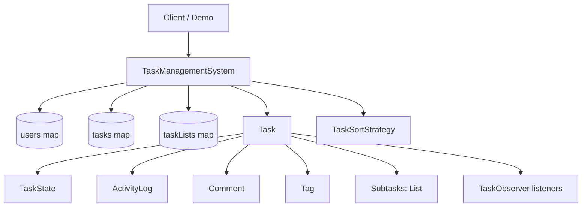
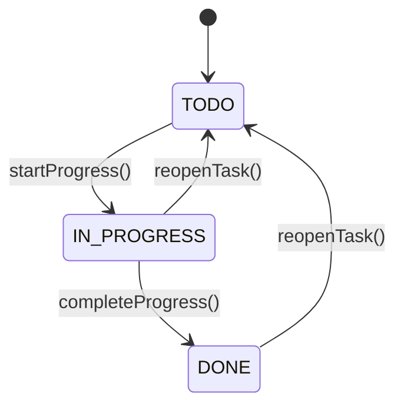
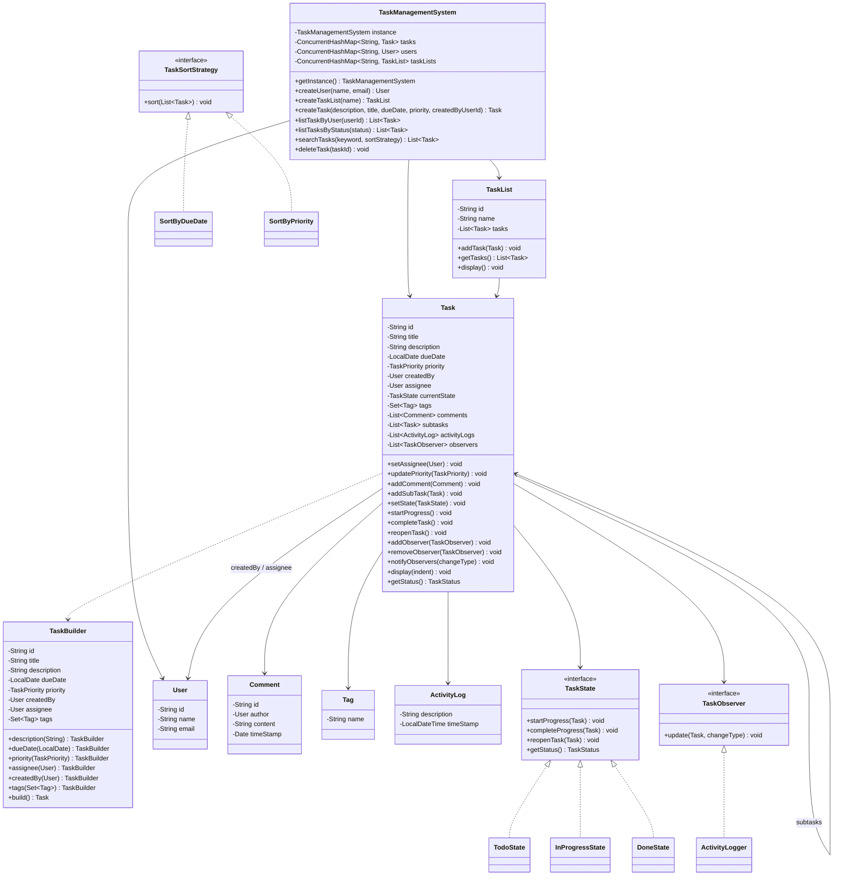
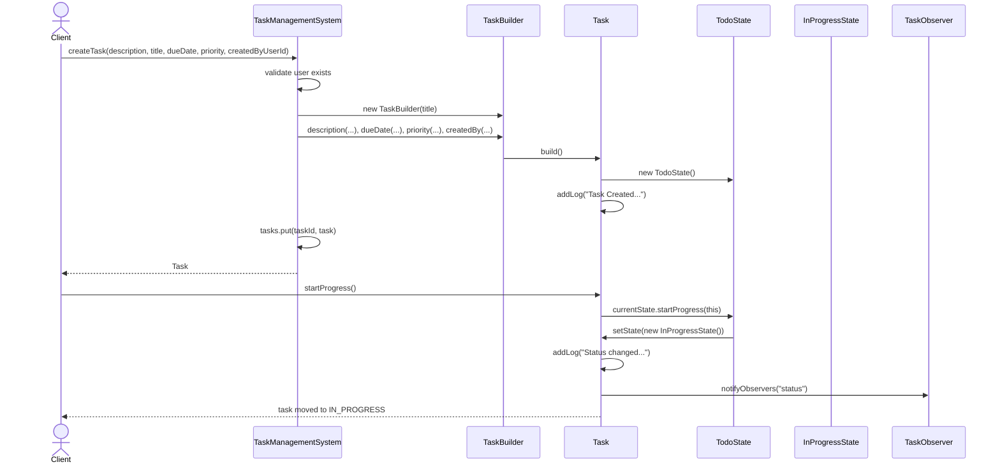

# Task Management System LLD

## Overview

This module implements a low-level design for a task management system. It models:

- users
- tasks
- task lists
- comments
- tags
- activity logs
- state transitions
- sorting strategies
- observer hooks
- subtask composition

The code is organized under `LLD.TaskManagementSystem` and uses a few common design patterns to keep creation, behavior, and extension points separate.

The central idea is:

1. `TaskManagementSystem` acts as the in-memory coordinator and repository.
2. `Task` is the main domain entity.
3. `TaskState` controls task status transitions.
4. `TaskSortStrategy` controls how search results are sorted.
5. `TaskObserver` allows external listeners to react to task changes.

---

## Folder Structure

```text
TaskManagementSystem/
|-- TaskManagementSystem.java
|-- TaskManagementSystemDemo.java
|-- enums/
|   |-- TaskPriority.java
|   `-- TaskStatus.java
|-- models/
|   |-- ActivityLog.java
|   |-- Comment.java
|   |-- Tag.java
|   |-- Task.java
|   |-- TaskList.java
|   `-- User.java
|-- observer/
|   |-- ActivityLogger.java
|   `-- TaskObserver.java
|-- state/
|   |-- DoneState.java
|   |-- InProgressState.java
|   |-- TaskState.java
|   `-- TodoState.java
`-- strategy/
    |-- SortByDueDate.java
    |-- SortByPriority.java
    `-- TaskSortStrategy.java
```

---

## What the System Supports

From the code, the module currently supports:

- creating users
- creating task lists
- creating tasks
- assigning tasks to users
- updating task priority
- adding comments
- adding subtasks
- tracking task activity logs
- listing tasks by status
- listing tasks assigned to a user
- searching tasks by keyword
- sorting search results by pluggable strategy
- displaying nested tasks
- transitioning task state between `TODO`, `IN_PROGRESS`, and `DONE`

---

## High-Level Architecture



---

## Core Classes

### 1. `TaskManagementSystem`

This is the top-level service class and acts as the in-memory manager of the module.

### Responsibilities

- hold all users in `ConcurrentHashMap<String, User>`
- hold all tasks in `ConcurrentHashMap<String, Task>`
- hold all task lists in `ConcurrentHashMap<String, TaskList>`
- create users
- create task lists
- create tasks
- search tasks
- filter tasks by status
- filter tasks by assignee
- delete tasks

### Important Methods

- `getInstance()`
- `createUser(String name, String email)`
- `createTaskList(String name)`
- `createTask(String description, String title, LocalDate dueDate, TaskPriority priority, String createdByUserId)`
- `listTaskByUser(String userId)`
- `listTasksByStatus(TaskStatus status)`
- `searchTasks(String keyword, TaskSortStrategy sortStrategy)`
- `deleteTask(String taskId)`

### Why it exists

Without this class, client code would need to directly manage user storage, task storage, validation, lookup, and search behavior. This class centralizes those responsibilities.

---

### 2. `Task`

This is the main domain object. Most business behavior lives here.

### Fields

- `id`: unique task identifier
- `title`: task title
- `description`: task details
- `dueDate`: expected completion date
- `priority`: task priority
- `createdBy`: creator of the task
- `assignee`: user currently assigned
- `currentState`: current state object implementing `TaskState`
- `tags`: set of task tags
- `comments`: list of comments
- `subtasks`: list of child tasks
- `activityLogs`: list of task activity entries
- `observers`: list of subscribed `TaskObserver`s

### Responsibilities

- manage mutable task data
- manage assignee updates
- manage priority updates
- manage comments
- manage subtasks
- manage activity logs
- delegate state transitions to the current `TaskState`
- notify observers when something changes
- display itself recursively with subtasks

### Key Methods

- `setAssignee(User assignee)`
- `updatePriority(TaskPriority priority)`
- `addComment(Comment comment)`
- `addSubTask(Task subTask)`
- `setState(TaskState state)`
- `startProgress()`
- `completeTask()`
- `reopenTask()`
- `addObserver(TaskObserver observer)`
- `removeObserver(TaskObserver observer)`
- `notifyObservers(String changeType)`
- `display(String indent)`

### Why behavior is kept here

`Task` owns the business state. Because of that, state changes such as assignment, status updates, comments, and subtasks are modeled as task behavior instead of raw setters scattered across the codebase.

---

### 3. `Task.TaskBuilder`

This inner static class is used to construct `Task` instances.

### Why Builder is used

`Task` has multiple fields, and only some of them are required at creation time. Builder gives:

- readable task creation
- controlled object construction
- fewer constructor overloads
- support for optional fields

Example:

```java
Task task = new Task.TaskBuilder("Launch feature")
        .description("Prepare release task")
        .dueDate(LocalDate.now().plusDays(2))
        .priority(TaskPriority.HIGH)
        .createdBy(user)
        .build();
```

This is more readable than a long constructor with many parameters of similar types.

---

### 4. `TaskList`

Represents a named collection of tasks.

### Responsibilities

- hold a list of tasks
- add tasks to the list
- return a copy of tasks via `getTasks()`
- display contained tasks

### Why it exists

Tasks are stored globally in `TaskManagementSystem`, but task lists group tasks by feature, area, sprint, or category.

---

### 5. `User`

Represents a user in the system.

### Fields

- `id`
- `name`
- `email`

### Responsibilities

- provide a unique identity for creator and assignee relationships

---

### 6. `Comment`

Represents a comment attached to a task.

### Fields

- `id`
- `author`
- `content`
- `timeStamp`

### Responsibilities

- model who commented
- hold comment text
- hold comment creation time

---

### 7. `Tag`

Represents a simple label attached to a task.

### Field

- `name`

---

### 8. `ActivityLog`

Represents a single audit-style entry for a task.

### Fields

- `description`
- `timeStamp`

### Responsibilities

- capture human-readable change history for the task

### Notes

`Task` appends logs internally using `addLog(...)` whenever important events happen.

---

## Enums

### `TaskPriority`

Represents task urgency:

- `LOW`
- `MEDIUM`
- `HIGH`
- `CRITICAL`

### `TaskStatus`

Represents task status:

- `TODO`
- `IN_PROGRESS`
- `DONE`

---

## State Layer

The state layer implements task lifecycle rules.

### Interface: `TaskState`

Defines:

- `startProgress(Task task)`
- `completeProgress(Task task)`
- `reopenTask(Task task)`
- `getStatus()`

### Concrete States

#### `TodoState`

Represents a task that has not started.

Behavior:

- `startProgress()` -> moves task to `InProgressState`
- `completeProgress()` -> prints invalid transition message
- `reopenTask()` -> prints already in TODO message

#### `InProgressState`

Represents active work.

Behavior:

- `startProgress()` -> prints already in progress
- `completeProgress()` -> moves task to `DoneState`
- `reopenTask()` -> moves task to `TodoState`

#### `DoneState`

Represents completed work.

Behavior:

- `startProgress()` -> prints cannot start completed task
- `completeProgress()` -> prints already done
- `reopenTask()` -> moves task to `TodoState`

### State Transition Diagram



### Why State Pattern is used

Without the State pattern, `Task` would need condition-heavy logic like:

```java
if (status == TODO) { ... }
else if (status == IN_PROGRESS) { ... }
else if (status == DONE) { ... }
```

State pattern moves transition rules into dedicated classes, which makes:

- transition rules easier to read
- invalid transitions explicit
- new states easier to add later

---

## Strategy Layer

The strategy layer handles sorting behavior for task search results.

### Interface: `TaskSortStrategy`

Defines:

- `void sort(List<Task> tasks)`

### Implementations

#### `SortByDueDate`

Sorts tasks by `dueDate` using:

```java
tasks.sort(Comparator.comparing(Task::getDueDate));
```

#### `SortByPriority`

Sorts tasks by priority in reverse enum order so higher priority tasks come first.

### Why Strategy Pattern is used

Search and sorting are separate concerns. The service should not hardcode one fixed sort order. By injecting a strategy, the caller decides how the result should be ordered.

This keeps `searchTasks(...)` open for extension without modifying the core search logic.

---

## Observer Layer

The observer layer is an optional extension point for external reactions to task changes.

### Interface: `TaskObserver`

Defines:

- `update(Task task, String changeType)`

### Implementation: `ActivityLogger`

Current behavior:

- prints a console log when a task changes

Example message shape:

```text
Logger:<task-title>was update. Change:<changeType>
```

### When observers are triggered

`Task.notifyObservers(changeType)` is called from:

- `setAssignee(...)`
- `updatePriority(...)`
- `addComment(...)`
- `addSubTask(...)`
- `setState(...)`

### Why Observer Pattern is used

Observer is useful when task changes should trigger secondary actions without tightly coupling them into `Task` itself.

Typical examples:

- console logging
- notifications
- email
- audit pipeline
- analytics
- webhook publishing

### Important implementation note

In `TaskManagementSystem.createTask(...)`, the line below is currently commented out:

```java
// task.addObserver(new ActivityLogger());
```

That means observers are supported by design, but not automatically attached during task creation in the current code.

---

## Class Diagram



---

## Design Patterns Used

### 1. Singleton Pattern

Used in: `TaskManagementSystem`

Why:

- the module wants one shared in-memory system instance
- client code can call `TaskManagementSystem.getInstance()`

Tradeoff:

- easy global access
- harder to test than dependency injection
- current implementation is not thread-safe during lazy initialization

---

### 2. Builder Pattern

Used in: `Task.TaskBuilder`

Why:

- `Task` has many attributes
- not all attributes are mandatory at creation time
- fluent construction improves readability

Tradeoff:

- construction is cleaner
- validation defaults must still be handled carefully

---

### 3. State Pattern

Used in: `TaskState`, `TodoState`, `InProgressState`, `DoneState`

Why:

- each task state has its own transition rules
- avoids bloated condition chains inside `Task`

Tradeoff:

- adds more classes
- makes transitions clearer and extensible

---

### 4. Strategy Pattern

Used in: `TaskSortStrategy`, `SortByDueDate`, `SortByPriority`

Why:

- sorting behavior changes independently of search behavior
- caller chooses ordering at runtime

Tradeoff:

- extra abstraction
- much cleaner extension path

---

### 5. Observer Pattern

Used in: `TaskObserver`, `ActivityLogger`, `Task.observers`

Why:

- allows decoupled reactions to task changes
- good for notifications and side effects

Tradeoff:

- can be overused if the side effect is actually part of core domain state
- currently task logging is already handled inside `Task`, so observer is better suited for external reactions than internal activity storage

---

### 6. Composite-Like Structure

Used in: `Task` containing `List<Task> subtasks`

Why:

- a task can contain child tasks
- `display()` recursively prints nested tasks

This is not a full formal Composite pattern implementation with a common component interface, but it uses the same hierarchical idea.

---

## Relationships and Ownership

### Ownership Summary

- `TaskManagementSystem` owns global maps of users, tasks, and task lists
- `TaskList` owns a list of task references
- `Task` owns comments, subtasks, logs, observers, and tags
- `TaskState` objects own transition behavior, not task data
- `TaskSortStrategy` objects own sort behavior, not search behavior

### Multiplicity Summary

- one `TaskManagementSystem` -> many `User`
- one `TaskManagementSystem` -> many `Task`
- one `TaskManagementSystem` -> many `TaskList`
- one `TaskList` -> many `Task`
- one `Task` -> zero or one `assignee`
- one `Task` -> one `createdBy`
- one `Task` -> many `Comment`
- one `Task` -> many `Tag`
- one `Task` -> many `ActivityLog`
- one `Task` -> many `TaskObserver`
- one `Task` -> many child `Task` subtasks
- one `Task` -> one active `TaskState`

---

## End-to-End Behavior by Method

This section explains what happens internally when a method is called.

### `TaskManagementSystem.getInstance()`

Flow:

1. Check whether static `instance` is `null`
2. If `null`, create a new `TaskManagementSystem`
3. Return the shared instance

Result:

- a single in-memory manager is reused

---

### `createUser(name, email)`

Flow:

1. Create a `User`
2. Generate a UUID inside `User`
3. Store user in `users` map using `user.getId()`
4. Return the `User`

---

### `createTaskList(name)`

Flow:

1. Create a `TaskList`
2. Generate a UUID inside `TaskList`
3. Store task list in `taskLists` map
4. Return the `TaskList`

---

### `createTask(description, title, dueDate, priority, createdByUserId)`

Flow:

1. Look up creator in `users` map
2. If creator does not exist, throw `IllegalArgumentException`
3. Create `Task` using `Task.TaskBuilder`
4. Builder passes values into `Task` constructor
5. `Task` constructor:
   - sets basic fields
   - sets `currentState = new TodoState()`
   - initializes `comments`
   - initializes `subtasks`
   - initializes `activityLogs`
   - initializes `observers`
   - appends a creation log
6. Store task in `tasks` map
7. Return the task

Notes:

- observer registration is currently not automatic because the sample `ActivityLogger` attachment is commented out

---

### `setAssignee(user)`

Flow:

1. Replace `assignee`
2. Add activity log entry
3. Notify all observers with change type `"assignee"`

---

### `updatePriority(priority)`

Flow:

1. Replace `priority`
2. Add activity log entry
3. Notify all observers with change type `"priority"`

---

### `addComment(comment)`

Flow:

1. Append comment to `comments`
2. Add activity log entry mentioning comment author
3. Notify all observers with change type `"comment"`

---

### `addSubTask(subTask)`

Flow:

1. Append subtask to `subtasks`
2. Add activity log entry
3. Notify all observers with change type `"subtask"`

Effect:

- `Task` becomes a composite root for nested display

---

### `startProgress()`

Flow:

1. `Task.startProgress()` delegates to `currentState.startProgress(this)`
2. Actual behavior depends on the active state object
3. If transition is valid, state object calls `task.setState(...)`
4. `setState(...)` replaces `currentState`
5. `setState(...)` adds activity log
6. `setState(...)` notifies observers with `"status"`

---

### `completeTask()`

Flow:

1. `Task.completeTask()` delegates to `currentState.completeProgress(this)`
2. If current state allows completion, it transitions to `DoneState`
3. `Task.setState(...)` logs and notifies observers

---

### `reopenTask()`

Flow:

1. `Task.reopenTask()` delegates to `currentState.reopenTask(this)`
2. If current state allows reopen, it transitions to `TodoState`
3. `Task.setState(...)` logs and notifies observers

---

### `listTaskByUser(userId)`

Flow:

1. Validate user exists in `users` map
2. Stream over `tasks.values()`
3. Filter tasks where `task.getAssignee()` equals the selected user
4. Return matching list

---

### `listTasksByStatus(status)`

Flow:

1. Stream over all tasks
2. Keep only tasks whose `task.getStatus()` equals the input status
3. Return the filtered list

---

### `searchTasks(keyword, sortStrategy)`

Flow:

1. Iterate through every task in `tasks`
2. Match tasks where title or description contains the keyword
3. Put matches into `matchingTask`
4. If no match exists, throw `IllegalArgumentException`
5. Call `sortStrategy.sort(matchingTask)`
6. Return sorted list

Why this is clean:

- searching remains in the service
- sorting behavior is injected from outside

---

### `display()`

For `TaskList.display()`:

1. Print task list header
2. Iterate through each root task
3. Call `task.display("")`

For `Task.display(indent)`:

1. Print current task with status, priority, and due date
2. If subtasks exist, recursively call `display(indent + "  ")`

Result:

- nested tasks are printed hierarchically

---

### `deleteTask(taskId)`

Current code flow:

1. Remove entry from `tasks` map using `taskId`
2. Remove entry from `taskLists` map using the same `taskId`

Important note:

- task IDs and task-list IDs are different concepts
- so removing from `taskLists` using `taskId` does not model task deletion correctly

---

## Sequence Diagram: Creating and Starting a Task



---

## Demo Walkthrough

The demo class `TaskManagementSystemDemo` shows the intended usage flow.

### Sequence in `main()`

1. Get singleton instance of `TaskManagementSystem`
2. Create two users
3. Create two task lists
4. Create three tasks
5. Add one task as a subtask of another task
6. Add tasks to task lists
7. Display the first task list
8. Start progress on the subtask
9. Assign the subtask to another user
10. Display the task list again
11. Search tasks using `SortByDueDate`
12. Filter tasks by `TaskStatus.TODO`
13. Complete the subtask
14. List tasks assigned to one user
15. Display the task list again
16. Delete one task

This demonstrates:

- creation flow
- hierarchical tasks
- state transitions
- assignment
- searching
- filtering
- strategy usage

---

## Current Design Choices That Are Visible in Code

These are not abstract ideas; they are directly visible in the current implementation.

### 1. In-memory storage instead of database

The system stores everything in `ConcurrentHashMap`s. There is no persistence layer.

What this implies:

- fast to prototype
- easy to understand
- data is lost when process exits

### 2. Rich domain object for `Task`

`Task` is not a passive data container. It owns business operations.

What this implies:

- task behavior is cohesive
- the entity is responsible for its own consistency

### 3. Service layer only at top level

`TaskManagementSystem` handles creation, lookup, and cross-task queries. Fine-grained domain changes happen inside `Task`.

### 4. Console-oriented demo

The demo is meant to exercise design patterns and interactions, not provide a production API or UI.

---

## Current Code Caveats and Mismatches

For complete understanding, it is important to separate intended design from current implementation details.

### 1. `TodoState.getStatus()` currently returns `DONE`

Current code:

- `TodoState.getStatus()` returns `TaskStatus.DONE`

Impact:

- newly created tasks may report the wrong status even though `currentState` is `TodoState`

Expected:

- `TodoState.getStatus()` should return `TaskStatus.TODO`

### 2. `deleteTask(taskId)` removes from `taskLists` using a task ID

Impact:

- task deletion does not remove the task from lists correctly
- removing from `taskLists` by task ID is conceptually incorrect

### 3. Observer support exists but is not wired by default

Impact:

- `notifyObservers(...)` runs only if some code manually calls `task.addObserver(...)`
- `ActivityLogger` is not active for created tasks unless explicitly attached

### 4. `Task` logs internally and also supports observers

Impact:

- internal logging and external observer logging overlap conceptually
- observer is best treated as an external side-effect hook, not the main activity-log owner

### 5. `Comment` constructor ignores input `id` and `timeStamp`

Current constructor behavior:

- generates a fresh UUID
- sets `timeStamp = new Date()`
- ignores the `id` and `timeStamp` arguments passed in

### 6. `TaskBuilder.tags` may stay `null`

Impact:

- tasks can be created with `tags == null`
- any future code that assumes tags are always initialized may fail

### 7. `TaskManagementSystem` singleton initialization is not synchronized

Impact:

- fine for the demo
- not ideal for concurrent production initialization

### 8. `ActivityLogger` imports `java.util.Observer` but does not use it

Impact:

- harmless
- unnecessary import

### 9. `addSubTask(...)` uses a generic log message

Current behavior:

- the code adds the subtask and logs a simple message
- log detail can be improved by including subtask title

---

## How All Pieces Fit Together

This is the conceptual chain:

1. The client talks to `TaskManagementSystem`.
2. `TaskManagementSystem` creates and stores domain objects.
3. `Task` owns its local business behavior.
4. `TaskState` decides whether a status transition is allowed.
5. `Task` records activity when important changes happen.
6. `Task` optionally notifies observers about those changes.
7. `TaskSortStrategy` controls how search results are ordered.
8. `TaskList` groups tasks for display and organization.

---

## Complete Runtime Flow

This section answers the full "what calls what, and what reaches where" question.

### A. When a client creates a task

1. Client calls `TaskManagementSystem.createTask(...)`
2. `TaskManagementSystem` validates `createdByUserId`
3. `TaskManagementSystem` creates `Task.TaskBuilder`
4. Builder collects the provided fields
5. Builder calls `build()`
6. `Task` constructor runs
7. `Task` sets:
   - identifiers and basic fields
   - `currentState = TodoState`
   - collections for comments, subtasks, logs, observers
8. `Task` immediately creates an `ActivityLog` entry for creation
9. `TaskManagementSystem` stores the task in `tasks`
10. Created `Task` reference is returned to the caller

### B. When a client starts task progress

1. Client calls `task.startProgress()`
2. `Task` forwards the call to `currentState.startProgress(task)`
3. Current state object decides what is allowed
4. If valid, state object calls `task.setState(new InProgressState())`
5. `Task.setState(...)`:
   - updates `currentState`
   - writes an activity log
   - notifies observers with change type `"status"`
6. Control returns to client

### C. When a client completes a task

1. Client calls `task.completeTask()`
2. `Task` delegates to `currentState.completeProgress(task)`
3. If the current state is `InProgressState`, it transitions to `DoneState`
4. `Task.setState(...)` handles log + observer notification

### D. When a client reopens a task

1. Client calls `task.reopenTask()`
2. `Task` delegates to `currentState.reopenTask(task)`
3. Current state object decides whether reopening is allowed
4. If allowed, `Task.setState(new TodoState())` is called
5. `Task` logs and notifies observers

### E. When a client assigns a task

1. Client calls `task.setAssignee(user)`
2. `Task` updates `assignee`
3. `Task` writes an activity log
4. `Task` notifies observers with `"assignee"`

### F. When a client adds a comment

1. Client calls `task.addComment(comment)`
2. `Task` appends to `comments`
3. `Task` logs the comment addition
4. `Task` notifies observers with `"comment"`

### G. When a client adds a subtask

1. Client calls `task.addSubTask(subTask)`
2. Parent task appends child task into `subtasks`
3. Parent task writes an activity log
4. Parent task notifies observers with `"subtask"`
5. Later, `display()` can recursively traverse the hierarchy

### H. When a client searches tasks

1. Client calls `searchTasks(keyword, strategy)`
2. `TaskManagementSystem` scans all tasks in memory
3. Matching tasks are collected
4. Chosen `TaskSortStrategy` sorts the matches
5. Sorted results are returned

### I. When a client lists tasks by status

1. Client calls `listTasksByStatus(status)`
2. `TaskManagementSystem` checks each stored task
3. `task.getStatus()` reads from the active `TaskState`
4. Matching tasks are returned

### J. When a client lists tasks by user

1. Client calls `listTaskByUser(userId)`
2. `TaskManagementSystem` validates that the user exists
3. Stored tasks are filtered by `task.getAssignee()`
4. Matching tasks are returned

### K. When observers are attached

1. Some client calls `task.addObserver(observer)`
2. Observer reference is stored in `task.observers`
3. Any later change that triggers `notifyObservers(changeType)` will call:

```java
observer.update(task, changeType);
```

4. Each observer performs its own reaction independently

In the current code, this flow exists structurally but does not run automatically for all tasks because no observer is attached by default in `createTask(...)`.

---

## Summary

This module is a good pattern-oriented LLD for a task system built around:

- a singleton coordinator
- a rich `Task` domain model
- state-based task lifecycle management
- strategy-based sorting
- optional observer hooks
- nested subtask composition

If someone reads only this README, they should understand:

- what classes exist
- what each class is responsible for
- how objects relate to each other
- why each pattern was chosen
- how task creation, updates, search, and state changes flow through the system
- where the current implementation still has rough edges

